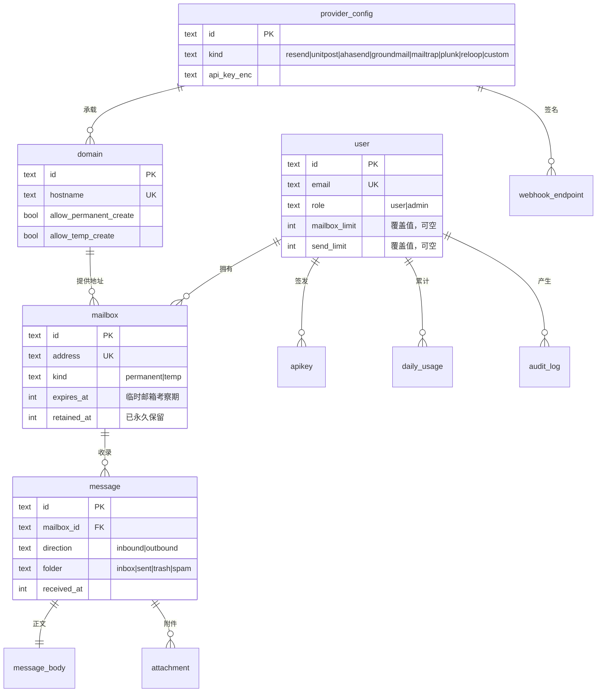

# 架构与设计

## 1. 定位与边界

asms2 是**邮件应用层**，不是邮件传输代理（MTA）。这句话决定了后面几乎所有设计，值得展开：

- **发件**交给域名绑定的那家服务商，`from` 必须是它已经验证过的域名。支持 Resend / UnitPost / AhaSend / Groundmail / Mailtrap / Plunk / Reloop，也可以接自建的 Resend 协议网关。
- **收件**靠对方代收：域名 MX 指过去，服务商收到后发 Webhook，我们再去拉正文。有的服务商事件里直接带正文，有的只给 ID，得回查一次。
- 因此**没有 SMTP / IMAP / POP3**，也**没法在投递阶段退信**。地址不存在或临时邮箱已过期，只能写 `unrouted_message` 或者丢弃，对外仍然返回 200。

这条边界带出来几个绕不过去的产品行为：临时邮箱过期就不复活、收不下的信需要墓碑表、投递状态只能等 Webhook 回写。

### 1.1 非目标

| 不做                                | 原因                                             |
| ----------------------------------- | ------------------------------------------------ |
| SMTP / IMAP / POP3                  | 不自建 MTA；对外暴露邮件协议是另一个量级的工程   |
| 富文本编辑器 / 日历 / 通讯录 / 网盘 | 超出"简单邮箱服务"                               |
| 邮箱共享与团队委派                  | v1 一人一邮箱，权限模型保持简单                  |
| 全文检索                            | 当前用主题/发件人 `LIKE`；Turso FTS 可用性未验证 |
| 多站点 / 多租户                     | 单实例单站点，站点配置单行                       |
| 自建反垃圾引擎                      | 依赖服务商抑制列表与退信机制                     |

## 2. 模块划分

| 模块          | 职责                                              | 代码位置                                                           |
| ------------- | ------------------------------------------------- | ------------------------------------------------------------------ |
| 用户面板      | 邮箱管理、收发件、筛选、配额、个人设置            | `src/routes/mail*`、`src/routes/settings.tsx`、`components/mail/*` |
| 管理面板      | 站点、域名、服务商、Webhook、登录方式、用户、日志 | `src/routes/admin*`、`components/admin/*`                          |
| 邮件适配层    | 统一收发/域名/Webhook 验签，错误归一              | `src/server/providers/*`                                           |
| 收件处理      | 验签 → 去重 → 解析收件人 → 拉正文 → 净化 → 入库   | `src/server/webhooks/process.ts`、`src/server/mail/ingest.ts`      |
| 发件服务      | 校验 → 配额 → 调服务商 → 落库                     | `src/server/mail/send.ts`                                          |
| 认证与权限    | Better Auth、角色、API Key、守卫                  | `src/server/auth/*`                                                |
| Telegram 通知 | Bot 配置、绑定码、update 分发、入站推送           | `src/server/telegram/*`、`src/routes/api/telegram/webhook.ts`      |
| 数据层        | Drizzle schema、libSQL 客户端、迁移               | `src/db/*`、`drizzle/*`                                            |
| 定时任务      | 过期邮箱、垃圾/墓碑清理                           | `src/server/jobs/sweep.ts`、`src/routes/api/cron/sweep.ts`         |

依赖方向（强约束）：

```
routes / components → server/fns → server/{mail,webhooks,jobs,telegram} → providers / db
```

反向依赖禁止：service 不引用路由，adapter 不读数据库与环境变量。

### 2.1 五条入口

进得来的一共五种请求，鉴权各不相同，别串了：

| 入口          | 路径                                    | 鉴权                              | 用途            |
| ------------- | --------------------------------------- | --------------------------------- | --------------- |
| 面板 RPC      | `createServerFn`                        | session cookie                    | 面板全部读写    |
| 对外 REST     | `/api/v1/*`                             | `x-api-key`                       | 脚本/第三方集成 |
| 收件回调      | `/api/webhooks/{provider}/{endpointId}` | svix 签名                         | 服务商推送      |
| Telegram 回调 | `/api/telegram/webhook`                 | `X-Telegram-Bot-Api-Secret-Token` | Bot 更新        |
| 定时任务      | `/api/cron/sweep`                       | `CRON_SECRET`                     | 过期与清理      |

### 2.2 适配层契约

`MailProvider` 是服务商唯一出口，业务层只认接口与 `ProviderError`：

| 方法                                         | 说明                                                          | 必需     |
| -------------------------------------------- | ------------------------------------------------------------- | -------- |
| `capabilities`                               | `{ send, receive, domainApi, webhook }`，管理面板据此灰化功能 | ✅       |
| `send(msg, cfg)`                             | 发件，返回 `{ providerMessageId }`                            | 发件必需 |
| `getInbound(id, cfg)`                        | 拉取收件正文与头（Webhook 已带正文时不会被调用）              | 收件必需 |
| `getAttachment?`                             | 附件下载（当前未接 UI）                                       | 可选     |
| `createDomain? / getDomain? / verifyDomain?` | 域名托管                                                      | 可选     |
| `verifyWebhook(raw, headers, cfg)`           | 验签并把事件归一为 `inbound / status / ignored`               | 收件必需 |

运行时配置 `{ apiKey, apiBaseUrl?, accountId?, webhookSecret? }` 由 service 解密后传进来，适配器自己不读库、不读 env，所以测试时直接塞一份配置就能跑。

七家都在：`resend`、`unitpost`、`ahasend`、`groundmail`、`mailtrap`、`plunk`、`reloop`，外加 `custom`（复用 Resend 协议）。业务层只认 `kind` 和归一后的事件，不会冒出任何服务商私有字段名——这条是硬约束，破了就等于把适配层作废。

## 3. 数据模型

### 3.1 实体关系



时间统一为 Unix **秒**（Drizzle `mode: 'timestamp'`），ID 为 nanoid 文本。

### 3.2 表清单

**认证（Better Auth 生成，6 张）**

| 表             | 关键字段                                                                    | 说明                                      |
| -------------- | --------------------------------------------------------------------------- | ----------------------------------------- |
| `user`         | id, email(UK), name, role, banned, `mailbox_limit`, `send_limit`, createdAt | 后两列为单用户配额覆盖，NULL 表示跟随站点 |
| `session`      | id, token(UK), userId, expiresAt, ipAddress, userAgent                      | 会话                                      |
| `account`      | id, userId, providerId, accountId, password, accessToken…                   | 密码与 OAuth，开启 token 加密             |
| `verification` | id, identifier, value, expiresAt                                            | 邮箱验证/重置                             |
| `passkey`      | id, userId, credentialID, publicKey, counter, deviceType, backedUp, aaguid  | `@better-auth/passkey` 插件               |
| `apikey`       | id, name, start, key(哈希), referenceId, rateLimit*                         | `@better-auth/api-key` 插件               |

**站点（3 张）**

| 表              | 关键字段                                                                                                                                                                                                                              | 说明                                                |
| --------------- | ------------------------------------------------------------------------------------------------------------------------------------------------------------------------------------------------------------------------------------- | --------------------------------------------------- |
| `site_settings` | 单行 `default`；站点资料、注册开关、`email_verification_required`、默认配额、前缀长度、`temp_ttl_minutes`（考察期）、`temp_grace_minutes`、冷却时长、`deleted_mailbox_retention_days`、`allow_temp_send`、`admin_can_read_mail`、时区 | typed 单行配置，零散扩展放 `extra_json`             |
| `auth_provider` | kind（email/google/github/oidc/passkey）、providerId(UK，运行时 ID 与回调路径段)、displayName、enabled、clientId、clientSecretEnc、issuer、scopes                                                                                     | 登录方式配置，保存后触发 auth 实例重建；OIDC 可多条 |
| `app_meta`      | key(PK), value                                                                                                                                                                                                                        | 配置版本号等                                        |

**邮箱与邮件（4 张）**

| 表             | 关键字段                                                                                                                                                | 说明                                                           |
| -------------- | ------------------------------------------------------------------------------------------------------------------------------------------------------- | -------------------------------------------------------------- |
| `mailbox`      | id, userId, domainId, localPart, address(UK), kind, status, expiresAt, **retainedAt**, lastReceivedAt, deletedAt                                        | 临时邮箱考察期结束前收件 → `retainedAt` 有值、`expiresAt=NULL` |
| `message`      | id, userId(冗余), mailboxId, direction, folder, providerMessageId, from/to/cc, subject, snippet, status, isRead, isStarred, attachmentCount, receivedAt | 列表只查此表，不拖正文                                         |
| `message_body` | messageId(PK/FK), htmlRaw, htmlSanitized, textBody, headersJson                                                                                         | 1:1，净化结果入库                                              |
| `attachment`   | id, messageId, providerAttachmentId, filename, contentType, size                                                                                        | 只存元数据，内容按需向服务商取                                 |

**服务商与域名（3 张）**

| 表                 | 关键字段                                                                                                                                                                  | 说明                                                       |
| ------------------ | ------------------------------------------------------------------------------------------------------------------------------------------------------------------------- | ---------------------------------------------------------- |
| `provider_config`  | id, kind, label, apiKeyEnc, apiKeyLast4, apiBaseUrl, externalAccountId, isDefaultForSend, status                                                                          | 同类型可多份，密钥 AES-256-GCM 加密；AhaSend 需 account_id |
| `domain`           | id, hostname(UK), providerConfigId, providerDomainId, **allowPermanentCreate**, **allowTempCreate**, status, receivingEnabled, sendingEnabled, isDefault*, dnsRecordsJson | 一域一商；两个 `allow*Create` 只管新建；`purpose` 已废弃   |
| `webhook_endpoint` | id(URL 中的 publicId), providerConfigId, label, signingSecretEnc, enabled, eventCount                                                                                     | 一商可多端点                                               |

**运营（4 张）**

| 表                 | 关键字段                                                                        | 说明                          |
| ------------------ | ------------------------------------------------------------------------------- | ----------------------------- |
| `daily_usage`      | userId, usageDate, sentCount, receivedCount，UK(userId,usageDate)               | 日发件配额计数                |
| `webhook_event`    | endpointId, providerEventId, type, status, payloadJson，UK(endpointId,eventId)  | 幂等去重 + 死信               |
| `unrouted_message` | providerMessageId, from, to, subject, reason(`unknown/expired/domain_disabled`) | 无法投递的墓碑，默认保留 7 天 |
| `audit_log`        | actorUserId, action, targetType, targetId, metaJson, ip, ua                     | 管理操作与管理员读信          |

### 3.3 关键索引与约束

- `mailbox(address)` UNIQUE；`(domain_id, local_part)` UNIQUE；`(user_id, kind, status)`；`(kind, status, expires_at)` 供清理扫描。
- `message(mailbox_id, folder, received_at)`、`(user_id, folder, received_at)`：单邮箱 / 全部邮箱列表。
- `message(provider_config_id, provider_message_id)` UNIQUE：收发幂等。
- `message(thread_key)`、`(internet_message_id)`：为后续线程聚合预留。
- `daily_usage(user_id, usage_date)` UNIQUE：配额 UPSERT 的冲突目标。
- `webhook_event(endpoint_id, provider_event_id)` UNIQUE：重复投递直接忽略；唯一例外是上次处理失败（`status='failed'`），此时允许服务商重投重跑并递增 `attempts`，其余状态一律按重复丢弃。

### 3.4 存储兼容

- 同一套 schema 支持 `file:./data/asms2.db` 与 `libsql://…turso.io`，驱动为 `@libsql/client`。
- 只使用两端都支持的 SQL：普通索引、UPSERT、`batch`；不用触发器、`ATTACH`、长事务。
- 多表写入用 `db.batch([...])`；远程库上避免事务内多次往返。
- 迁移与备份流程见 [database.md](./database.md)。

## 4. 权限模型

### 4.1 角色

| 角色   | 来源                | 说明                           |
| ------ | ------------------- | ------------------------------ |
| 访客   | 无 session          | 仅登录/注册页与公开站点信息    |
| 用户   | `user.role='user'`  | 只能操作自己的资源             |
| 管理员 | `user.role='admin'` | 配置与治理；默认不可读邮件正文 |

首个管理员：`BOOTSTRAP_ADMIN_EMAIL` 对应账号在**站内无管理员**时自动提权（注册后触发一次）。

### 4.2 权限矩阵

| 资源 / 动作                        | 访客 | 用户                 | 管理员                     |
| ---------------------------------- | ---- | -------------------- | -------------------------- |
| 站点公开信息                       | 读   | 读                   | 读写                       |
| 域名 / 服务商 / Webhook / 登录方式 | —    | —                    | 读写                       |
| 创建长期邮箱                       | —    | 受配额（默认 5）     | 受配额                     |
| 创建临时邮箱                       | —    | 不限量，受频率限制   | 同用户                     |
| 删除/停用自己的邮箱                | —    | ✅                   | ✅                         |
| 查看邮件                           | —    | 仅自己               | 元数据全站；正文默认不可见 |
| 发件                               | —    | 仅长期邮箱，受日限额 | 同用户（不代发）           |
| API Key                            | —    | 自己签发/吊销        | 同用户                     |
| 用户管理（封禁/配额）              | —    | —                    | ✅                         |
| 审计日志                           | —    | 仅自己的关键操作     | 全站                       |

### 4.3 三道闸

1. **路由**：`/mail`、`/settings`、`/admin` 在 `beforeLoad` 校验 session；`/admin` 再校验 `role`，非管理员抛 404（不暴露存在性）。
2. **server function**：每个函数首行 `requireUser()` / `requireAdmin()`；写操作只走 POST。
3. **查询层**：所有查询显式带 `userId`；跨资源操作先 `getMailboxOrThrow(userId, id)`。

### 4.4 隐私与审计

- `admin_can_read_mail` 默认关闭；开启后读正文也需填写理由并写 `audit_log`。
- 服务商 Key、OAuth Secret、Webhook Secret 只存密文，接口只回末四位或 `hasSecret`。
- 封禁用户立即停止收发并使会话失效，邮件保留 30 天。

## 5. 关键流程

### 5.1 收件

```
服务商代收（域名 MX 指向它）
  → POST /api/webhooks/{kind}/{endpointId}
  → 查端点 → 取密钥 → 按 kind 验签（±5 分钟）
  → 插入 webhook_event（endpointId + eventId 唯一）→ 冲突即 200
  → 按归一事件分发：inbound 入库；status 更新出站状态；ignored 记日志
  → 200（处理失败才 5xx 触发重试）
```

入库细节：

1. 取 `to[]` 归一化，按 `address` 查 `mailbox`（唯一索引）。
2. 命中且有效 → 继续；临时邮箱 `expiresAt` 已过 → 写 `unrouted_message(expired)`；未命中 → `unknown`。
3. 调服务商的 `getInbound()` 拉正文，超时 15s；AhaSend 的 `message.routing` 已在事件里带正文，跳过这一步。失败抛 5xx 让服务商重试。
4. `sanitize-html` 白名单净化，生成 snippet 与纯文本。
5. `db.batch` 写 `message` + `message_body` + `attachment` + 更新 `mailbox`（临时邮箱同时置 `retainedAt`、清空 `expiresAt`）+ 收件计数。
6. 唯一键冲突视为重复投递，返回 200。

### 5.2 发件

```
鉴权 → 校验邮箱归属/长期/域名已验证且允许发信
  → 预留配额（原子 UPSERT）
  → 选服务商（域名绑定）
  → adapter.send（idempotencyKey = send/{mailboxId}/{uuid}）
  → 成功落库；不可重试失败回滚配额
  → 投递、退信、投诉等事件归一为 status 回写状态
```

- 附件：base64 传给服务商，单封 ≤10MB、≤3 个。
- 临时邮箱默认不可发信（`allow_temp_send`）。
- 失败可重试（5xx/429）时保留配额，由用户重试；4xx 明确失败则回滚。

### 5.3 临时邮箱生命周期

只有一条规则：**创建后 1 小时是考察期，期内收到任意一封邮件就永久保留**——`retainedAt` 落时间、`expiresAt` 置空。一封都没等到，到期就失效，而且不会复活。

| 时刻          | 事件     | expiresAt | retainedAt | 状态                 |
| ------------- | -------- | --------- | ---------- | -------------------- |
| T0            | 创建     | T0+60m    | NULL       | active               |
| T0+18m        | 收到首封 | NULL      | T0+18m     | active（已保留）     |
| T0+60m        | 始终无信 | 不变      | NULL       | expired              |
| 到期+grace    | 清理任务 | —         | —          | 邮件清空，邮箱留墓碑 |
| 到期+cooldown | 地址释放 | —         | —          | 可被重新注册         |

- 读取时惰性判定 + 每分钟 cron 落库，双保险；已保留的 `expiresAt` 为 NULL，不会被清理。
- 到期后不复活，迟到邮件进墓碑。
- 创建限流：20/小时/用户（服务端硬编码，见 `createMailbox`）。

### 5.4 配额

- 长期邮箱：`user.mailbox_limit` → `site_settings.default_mailbox_limit`（5）。停用的邮箱仍占额度。
- 日发件：`user.send_limit` → `default_daily_send_limit`（5），按站点时区切日。
- 预留用单条 `INSERT … ON CONFLICT … DO UPDATE … WHERE sent_count < limit`，受影响行数为 0 即超额。
- 失败回滚 `refundSendQuota`；超时等未知结果不回滚（宁可少发不可超发）。

### 5.5 列表与筛选

- 路由：`/mail?mailbox=&folder=&q=`，`folder` 限定 `inbox|sent|spam|trash|archive`。
- 默认全部邮箱聚合；指定 `mailbox` 时走 `(mailbox_id, folder, received_at)` 索引。
- 游标为 `receivedAt_id`，一次取 31 条判断 `hasMore`；未读数用一条 `GROUP BY` 聚合。
- 搜索仅主题 + 发件人 `LIKE`，范围限定当前用户。

### 5.6 域名接入

1. 选服务商 → 填主机名（建议 `mail.example.com`）→ 勾选允许新建的邮箱类型。
2. 调 `createDomain` 获取 DNS 记录并落库。
3. 管理员到 DNS 服务商添加记录（MX 优先级 10、SPF、DKIM）。
4. 点「验证」→ `verifyDomain` 后轮询 `getDomain` 状态。
5. 开启接收/发送、设置默认域。

根域要是已经有 MX（Google Workspace、企业邮之类），必须改用子域。不然加记录的那一刻，整个域的来信都会被导去服务商。

### 5.7 登录方式（动态）

登录方式都塞在 `auth_provider` 一张表里：`kind` 决定类型（`email` 邮箱密码，默认开、`google`、`github`、`oidc`、`passkey`），`providerId` 是运行时唯一 ID。
内置类型（email/google/github/passkey）的 `providerId` 固定等于 `kind`；`oidc` 允许添加多条，每条用管理员自定义的 `providerId`（小写字母/数字/中划线）作为回调路径段。
Better Auth 的 `emailAndPassword` / `socialProviders` / 插件列表在实例创建时固定，因此 `getAuth()` 是带版本号的异步单例：

- 管理面板保存 → `app_meta.auth_config_version` 自增 → 进程内 `invalidateAuthCache()`。
- 下次请求发现版本变化即重建实例；多实例靠 30s 版本轮询生效。
- 回调地址为 `{BETTER_AUTH_URL}/api/auth/callback/{providerId}`；OIDC 的 `providerId` 即自定义回调标识。
- 至少保留一种启用的方式：停用/删除最后一种由服务端拒绝（409）。
- 删除方式只删配置行，`account` 里的密码/社交凭证保留；重新添加后仍可登录。
- Passkey 的 `rpID` / `origin` 取自 `BETTER_AUTH_URL`，因此生产必须使用 HTTPS。

账号绑定（`account.accountLinking`）：

- 已启用的 OAuth 方式全部进 `trustedProviders`：管理员配置的 IdP 即本站可信来源，绑定不再依赖 IdP 返回 `email_verified`。
- `allowDifferentEmails: true`：允许绑定邮箱不同的账号（个人 GitHub 常见）；前提是已登录并完成目标平台授权。
- `/settings`「第三方账号」列出已绑定的 `account` 行与仍可绑定的方式，解绑走 `unlinkSsoAccountFn`（带 `userId` 兜底 + 审计日志）。
- 解绑后登录方式不能归零：服务端按 `account` 行 + Passkey 计数，剩最后一种时拒绝。
- 管理员用户页按 `account` 行展示「登录来源」，OIDC 取 `auth_provider.display_name`，Passkey 单独计数。

邮箱验证（`site_settings.email_verification_required`）：

- 只影响邮箱密码注册的新用户；开启时会把存量用户回填为已验证，避免全员被锁。
- 验证邮件复用站点服务商 + 已验证且开启发信的域名（发件人 `noreply@{hostname}`），不占用户配额。
- 未验证用户仍可登录，但 `/mail`、`/settings`、`/admin` 会重定向到 `/verify-email`。

## 6. 前端

### 6.1 路由

| 路由                                                        | 页面                                        |
| ----------------------------------------------------------- | ------------------------------------------- |
| `/login`、`/register`                                       | 认证（按站点配置渲染登录方式）              |
| `/verify-email`                                             | 邮箱验证提醒与重发                          |
| `/mail`、`/mail/$messageId`                                 | 三栏邮件界面，阅读区可深链                  |
| `/settings`                                                 | 昵称、配额、登录与安全、第三方账号、API Key |
| `/admin`、`/admin/{site,domains,providers,auth,users,logs}` | 管理后台                                    |

### 6.2 布局

- 侧栏 272px（手机端抽屉）→ 列表 380–420px → 阅读区自适应；≤768px 列表与阅读二选一。
- 写信用 Modal，新建邮箱用 Modal；管理表格用卡片行 + Switch。

### 6.3 组件

| 界面        | 复用的 BoardUI 组件                                                                    |
| ----------- | -------------------------------------------------------------------------------------- |
| 登录 / 注册 | `AuthCard` + `SocialButton` + `LoginMethodButtons` + `Input` + `Button`                |
| 应用外壳    | `Button` / `IconButton` / `Avatar` / `Counter` / `Dropdown` / `Drawer` / `ThemeToggle` |
| 新建邮箱    | `Modal` + `SegmentedControl` + `Input` + `Select`                                      |
| 写信        | `Modal` + `Select` + `Input` + `Textarea` + `Button`                                   |
| 邮件列表    | 组合行（`Counter` `Skeleton` `Spinner`），非表格                                       |
| 阅读器      | `IconButton` + `Chip` + `Divider` + sandbox `iframe`                                   |
| 管理后台    | `PageSection`（组合）+ `Switch` + `Select` + `Input` + `Chip` + `Modal`                |

- 一律优先使用 `components/` 下的 BoardUI 组件；缺件先 `npx boardui@latest add <name>`，不手写替代品。
- 没有现成件的「邮箱列表 / 邮件行 / 阅读器」由 BoardUI 原语组合，只用语义 token 与复合排版类。
- 正文渲染在 `sandbox` iframe 中，默认禁止远程图片（可手动加载）。

### 6.4 数据获取

- Query key：`['mailboxes']`、`['messages', filters]`、`['message', id]`、`['quota']`、`['admin', resource]`。
- 列表 20s 轮询、邮箱列表 60s；已读/星标乐观更新后失效缓存。
- server function 返回 `{ ok, data | error }`，统一 `unwrap()` 抛错给 UI。
- 快捷键：`c` 写信、`/` 聚焦搜索；写信为 Modal，阅读为可深链路由。

## 7. 安全要点

- **XSS**：三道都得在——入库前 `sanitize-html` 白名单净化、渲染放进 sandbox iframe、再叠一层 CSP。少一道就等着账号被端。
- **密钥**：AES-256-GCM，IV 和 tag 跟密文一起存。`SECRET_ENCRYPTION_KEY` 丢了，库里所有服务商 Key、OAuth Secret 都得重录，没有后门。
- **CSRF**：Better Auth 自带；自己写的写接口要额外校验来源。
- **枚举**：建邮箱必须登录，也不对外提供"这个地址存不存在"的查询。
- **滥用**：日发件限额、临时邮箱创建限流、可全站停发，投诉率超阈值就停用域名。
- **SSRF**：净化阶段不抓任何远程资源；邮件里的图片是浏览器直连，服务端不代取。
- **审计**：管理写操作、读信、密钥变更全部落 `audit_log`。

## 8. 技术选型与关键决策

### 8.1 选型

| 层   | 选型             | 理由                                                                     |
| ---- | ---------------- | ------------------------------------------------------------------------ |
| 框架 | TanStack Start   | 同仓库 server function + SSR，类型贯通；Nitro 可部署到 Node/VPS          |
| UI   | BoardUI          | 源码级组件、语义 token、暗色自动；避免自研基础件                         |
| 数据 | Drizzle + libSQL | 一套 schema 同时跑本地 SQLite 与 Turso，迁移可审                         |
| 认证 | Better Auth      | 内置 email/password、OAuth、admin、apiKey 插件，Drizzle adapter 官方支持 |
| 邮件 | 多服务商适配层   | 七家都能接；业务层不绑死任何一家，换服务商只换配置文件                   |

### 8.2 关键取舍

| 决策                       | 原因                                 | 代价                         |
| -------------------------- | ------------------------------------ | ---------------------------- |
| 不自建 MTA，收信交给服务商 | 省掉 SMTP 服务、队列、反垃圾这一整套 | 退不了信；正文常常要二次拉取 |
| 地址作为唯一路由键         | 收件 O(1) 定位；地址全局唯一，好审计 | 一封多收件人只投第一个       |
| 临时邮箱「首封即永久」     | 临时试用，有用就留下，比按天续命简单 | 需要 `retainedAt` 区分状态   |
| 域名级新建开关而非全局     | 可把长期域与临时域隔离，降低信誉风险 | 管理面板多两个开关           |
| 配额原子 UPSERT            | 并发下不超发                         | 失败回滚依赖错误分类         |
| 不删列、只加列             | 避免 SQLite 重建表伤及外键           | 会留下 `purpose` 这类废弃列  |
